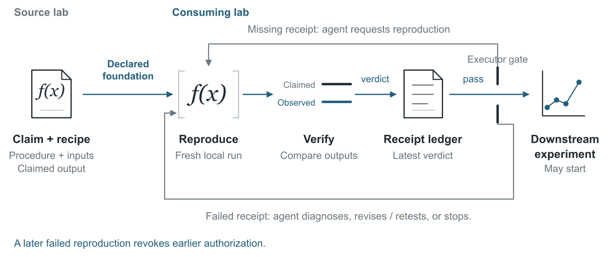
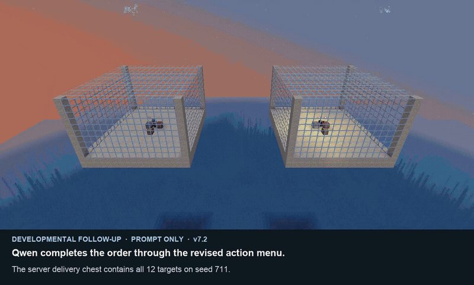

# Verify Before You Build

**Executable Dependency Gates for Agent-Generated Science**  
Mariia Baidachna and Alina Nesen · NeurIPS 2026 AI for Science workshop

A consuming research agent may read or cite a result, but a declared foundational dependency must have a current passing reproduction receipt before the executor admits downstream use. A failed reproduction can revoke a previous pass. The repository contains the paper, the Python gate artifact, and the complete Minecraft pilot and development evidence.

[Paper PDF](paper/paper.pdf) · [LaTeX](paper/main.tex) · [Python evaluation](python/evaluation/evaluation_results.json) · [Minecraft pilot](minecraft-verification/PILOT-RESULTS.md) · [All follow-up attempts](minecraft-verification/FOLLOWUP-RESULTS.md) · [Reproduction guide](REPRODUCING.md)

## Verify before you build



## Minecraft experiment demo

[](https://github.com/Entangled-Research/verify-before-you-build/raw/refs/heads/main/media/minecraft-demo.mp4)

[Watch the full 18-second recording](https://github.com/Entangled-Research/verify-before-you-build/raw/refs/heads/main/media/minecraft-demo.mp4). Recorded Minecraft footage shows the enforced verification follow-up, including a failed blast-furnace test, a repaired procedure, and a passing retest before production. Playback is accelerated, with captions describing the experiment events. See the [follow-up experiment records](minecraft-verification/FOLLOWUP-RESULTS.md) for outcomes and context.

## What was measured

- The Python evaluator returned the expected allow/block decisions for **13 predefined policy cases**. These are software policy tests, not 13 scientific research tasks.
- The original Minecraft pilot used the same model, interface, order and seed across no-gate, prompt-only and enforced arms. They delivered **2/12, 2/12 and 0/12** items. Enforced admitted zero unverified production starts.
- Four later development attempts are all retained: **3/12, 12/12, 1/12 and 12/12**. The successful prompt-only v7.2 and enforced v7.3 episodes used a focused queue, recipe-book repair suggestions and improved feedback. They had different feedback versions, and there was no same-version no-gate comparison. They establish assisted completion, not a causal benefit from verification.
- Test-kit allocations, observed local-model tokens, wall time, interrupted attempts and failed calibrations are reported. No monetary API cost or inference-compute saving is established.

The Minecraft code is a standalone adapter. Known crafting recipes and deliberately omitted prerequisites provide controlled checks of declared procedure reuse; they do not measure discovery of unknown science. The gate does not detect hidden dependencies in direct reimplementations.

## Inspect the evidence without a game or model

Python 3.10+ and the standard library are sufficient:

```sh
cd python/supplement
python3 -B -m unittest -v test_verifier.py
cd ../..
python3 -B portable/check-evidence.py
```

The first command checks all 13 policy decisions and exact/altered metric verdicts. The second confirms all seven episode outcomes and reconciles both completed follow-ups' raw model choices, executed tools, receipts and server delivery observations.

For the unchanged offline Minecraft adapter tests, install Node.js 22+ and the small pinned dependency set:

```sh
npm ci --prefix dependencies --ignore-scripts
node portable/test-minecraft.mjs
node portable/minecraft.mjs v6 preflight --offline
node portable/minecraft.mjs v7.3 preflight --offline
```

These commands do not connect to Minecraft or run a model. Live reproduction is documented separately in [REPRODUCING.md](REPRODUCING.md); it requires an independently installed game and cached model.

## Repository map

| Path | Contents |
| --- | --- |
| `paper/` | Final revised manuscript, bibliography, style, figures and editable figure generators |
| `python/supplement/` | Standalone standard-library gate and deterministic verdict fixture |
| `python/evaluation/` | Original framework evaluator and archived policy, metric and latency results |
| `python/framework-excerpts/` | Licensed historical Efferents source excerpts for inspection; not a complete framework installation |
| `minecraft-verification/runs/` | Archived agent episodes and separate calibration/interface diagnostics |
| `minecraft-verification/prepared-*` | Frozen protocols, prompts, libraries, datapacks and source identities |
| `minecraft-verification/followup-evidence-v7/` | Audits, comparison CSV and independent final chest readback |
| `portable/` | New portability wrappers and read-only evidence checker |
| `provenance/` | Original/published hashes and explicit publication redactions |

The full framework evaluator trains and scores a deterministic logistic-regression example. The smaller standalone supplement returns five predetermined metric values to exercise verdict logic. Those are distinct code paths and their timings must not be conflated.

This export begins with a single initial commit. Original experiment identities remain in the evidence. See [NOTICE.md](NOTICE.md) for licensing scope, Minecraft artwork attribution and the documented author-path redactions.
